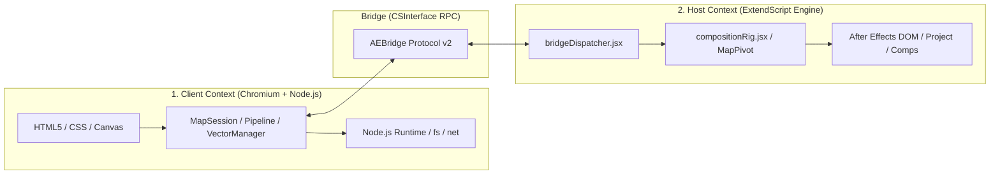
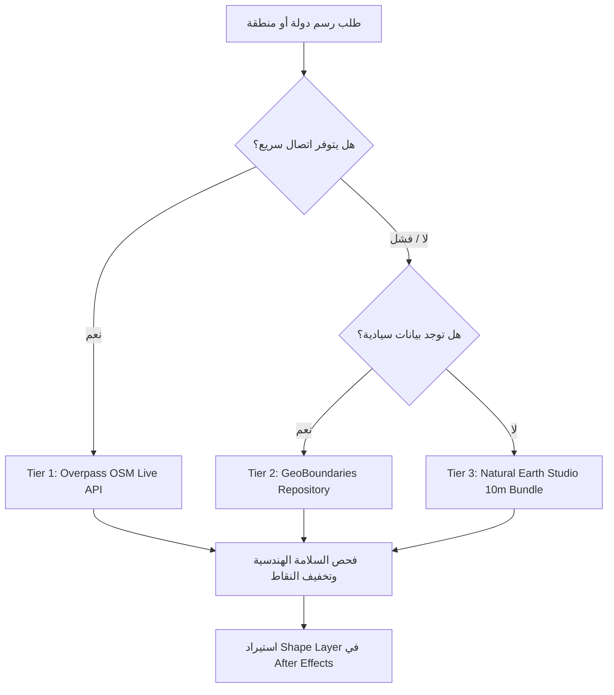

# 📘 دليل المطور الشامل وهندسة نظام OpenGeo (Developer Blueprint & Handbook)
> **دليل الانطلاق الفوري للتطوير المستقبلي** — كُتب هذا المستند ليكون المرجع الهندسي الشامل والوحيد الذي يحتاجه أي مبرمج (أو أنت عند عودتك للمشروع مستقبلاً) لفهم كافة أسرار وتفاصيل البنية البرمجية والبدء في التعديل والإضافة فوراً دون أي حيرة.

---

## 📑 فهرس المحتويات
1. [الهندسة العامة وبيئة التشغيل (Architecture & Runtime Overview)](#1-الهندسة-العامة-وبيئة-التشغيل)
2. [خريطة المجلدات ومسؤوليات الملفات (Codebase Directory Map)](#2-خريطة-المجلدات-ومسؤوليات-الملفات)
3. [نقطة الانطلاق ودورة إقلاع الإضافة (Bootstrapping Lifecycle)](#3-نقطة-الانطلاق-ودورة-إقلاع-الإضافة)
4. [الأنظمة والمحركات الجوهرية بالتفصيل (Core Subsystems Deep Dive)](#4-الأنظمة-والمحركات-الجوهرية-بالتفصيل)
   - [أ. محرك الكاميرا ومطابقة المنظور 3D (Camera Sync & 3D Frustum Engine)](#أ-محرك-الكاميرا-ومطابقة-المنظور-3d)
   - [ب. محرك البلاطات وتجميع الصور (Tile Pipeline & MegaTile Stitcher)](#ب-محرك-البلاطات-وتجميع-الصور)
   - [ج. محرك الفيكتور متعدد التفاصيل (Vector Cartography & Multi-Tier LOD)](#ج-محرك-الفيكتور-متعدد-التفاصيل)
   - [د. بروتوكول الجسر مع After Effects (Bridge Protocol v2)](#د-بروتوكول-الجسر-مع-after-effects)
   - [هـ. كتالوج الأحداث الصارم (Event Contracts Architecture)](#هـ-كتالوج-الأحداث-الصارم)
   - [و. إدارة الحالة واللقطات المجمدة (State Machine & Snapshots)](#و-إدارة-الحالة-واللقطات-المجمدة)
5. [أوامر التطوير والاختبارات اليومية (Developer Commands & QA)](#5-أوامر-التطوير-والاختبارات-اليومية)
6. [الضوابط والقواعد الذهبية للتطوير (Golden Architectural Laws)](#6-الضوابط-والقواعد-الذهبية-للتطوير)
7. [كيف تُضيف ميزة جديدة؟ (Step-by-Step Feature Implementation)](#7-كيف-تُضيف-ميزة-جديدة)
8. [تصحيح الأخطاء وحل المشاكل (Debugging & Troubleshooting)](#8-تصحيح-الأخطاء-وحل-المشاكل)

---

## 1. الهندسة العامة وبيئة التشغيل

إضافة **OpenGeo** هي ملحق هجين متقدم (Adobe CEP Hybrid Extension) يتكون من بيئتين برمجيتين منفصلتين تعملان بتزامن دقيق:



1. **بيئة العميل (Client Frontend):**
   - تعمل داخل متصفح **Chromium** مدمج في Adobe CEP (الإصدارات 10 و 11 و 12+).
   - تمتلك وصولاً كاملاً لـ **Node.js** عبر سياق CEP لتنفيذ عمليات الملفات والشبكة وحسابات التشفير.
   - مسؤولة عن: واجهة المستخدم (Zero-Radius CSS Design System)، عرض الخريطة التفاعلية في الكانفاس 2D و 3D، استعلامات الـ API، وتخطيط البلاطات.

2. **بيئة المضيف (ExtendScript Host):**
   - تعمل داخل محرك جافاسكريبت القديم الخاص بـ Adobe After Effects (ECMAScript 3 مع بعض امتدادات Adobe).
   - مسؤولة عن: إنشاء الكومبوزيشنات، استيراد البلاطات وتوليد طبقات الـ Footage، ربط تعبيرات الكاميرا ثلاثية الأبعاد (3D Camera Rig)، وتوليد طبقات الأشكال المتجهة (Shape Layers).

3. **حلقة الوصل (Bridge Boundary):**
   - يتم التخاطب بين البيئتين عبر `window.__adobe_cep__.evalScript` أو كائن `CSInterface`، محكوماً ببروتوكول صارم يُدعى `Bridge Protocol v2`.

---

## 2. خريطة المجلدات ومسؤوليات الملفات

```
OpenGeo/
├── .debug                  # منافذ تصحيح الأخطاء عبر المتصفح (Port 8088 للـ Chrome DevTools)
├── CSXS/
│   └── manifest.xml        # تعريف الإضافة لدى أدوبي، الصلاحيات، منافذ العرض، وإصدارات CEP
├── client/                 # كود الواجهة الأمامية بالكامل
│   ├── index.html          # الصفحة الرئيسية والهيكل البصري للواجهة
│   ├── css/modules/        # نظام التصميم المقسم ذرياً (01-variables إلى 06-telemetry)
│   ├── js/
│   │   ├── app.js          # منسق التطبيق الرئيسي ومُطلق دورة الحياة (Bootstrap)
│   │   ├── config.js       # إعدادات المزودين الافتراضية، المفاتيح، والحدود الجغرافية
│   │   ├── MapState.js     # الحالة الهندسية للخريطة (Zoom, Coordinates, Frame Dimensions)
│   │   ├── ae/             # محركات التزامن وحفظ الميتاداتا داخل After Effects
│   │   │   ├── AESyncEngine.js      # محرك الاستطلاع الدوري (Polling) لمزامنة الكاميرا لحظياً
│   │   │   └── MetadataManager.js   # قراءة وحفظ إعدادات الخريطة كميتاداتا JSON داخل الكومبوزيشن
│   │   ├── core/           # النواة المنطقية وإدارة العمليات
│   │   │   ├── AEBridge.js          # وسيط التخاطب المنمط (Typed RPC) مع ExtendScript
│   │   │   ├── MapSession.js        # المصدر الموحد للحقيقة (Single Source of Truth) لكامل الحالة
│   │   │   ├── CompositionController.js # إدارة تحميل وتبديل الكومبوزيشنات وتحديث الإطار
│   │   │   ├── FinalizeController.js    # إدارة تصدير الخريطة النهائية عالية الدقة
│   │   │   ├── VectorMapManager.js  # محرك استعلام وتوليد طبقات الفيكتور (OSM/GeoBoundaries)
│   │   │   ├── StateHydrator.js     # استعادة وتطهير الحالة عند فتح مشاريع سابقة
│   │   │   └── OperationSnapshot.js # لقطات الحالة غير القابلة للتعديل لعزل العمليات الخلفية
│   │   ├── engine/         # محركات التنزيل والأنابيب الحسابية للراستر والفيكتور
│   │   ├── events/
│   │   │   └── EventContracts.js    # كتالوج الأحداث المركزي الصارم (العمود الفقري للأحداث)
│   │   ├── map/            # الرياضيات الجيومكانية والكانفاس
│   │   │   ├── MercatorProjection.js # معادلات تحويل خطوط الطول والعرض إلى بكسلات
│   │   │   ├── Viewport.js          # الواجهة البرمجية (Façade) للتحكم في الكاميرا والزوم
│   │   │   └── MapRenderer.js       # محرك رسم البلاطات والفيكتور والـ 3D Frustum Buffer
│   │   ├── overlays/       # طبقات المعاينة (GeoJSON, Markers, CountryHighlightLayer)
│   │   ├── tiles/          # تخطيط واستدعاء بلاطات الخريطة
│   │   │   └── CoveragePlanner.js   # خوارزمية تحديد البلاطات المغطية للرؤية مع الـ Overscan
│   │   └── ui/             # وحدات التحكم في عناصر الواجهة (HUD, Scrubber, Search, Dialogs)
│   │       ├── LocationHudController.js # التحكم في إمالة الـ 3D وعداد الدرجات والشريط المتري
│   │       └── InputHandler.js      # التقاط إيماءات الماوس (السحب، الزوم، الإمالة بالزر الأيمن)
├── host/                   # كود ExtendScript الذي يعمل داخل Adobe After Effects
│   ├── index.jsx           # نقطة الدخول الرئيسية، استدعاء الموديولات وتفعيل مساحة الأسماء
│   └── modules/
│       ├── bridgeDispatcher.jsx     # موجه الأوامر المركزي (RPC Router)
│       ├── compBuilder.jsx          # بناء الكومبوزيشن الداخلي والخارجي وهيكل المجلدات
│       ├── compositionRig.jsx       # تركيب الكاميرا ثلاثية الأبعاد وتعبيرات MapPivot
│       ├── compositionTiles.jsx     # استيراد البلاطات وترتيبها وتطبيق الـ Gutter
│       ├── metadataSync.jsx         # استعلام حالة الكاميرا الحية وتحديث قيم خطوط الطول والزوم
│       └── vectorHost.jsx           # توليد أشكال الفيكتور الحقيقية (Shape Layers)
├── scripts/                # سكريبتات الأتمتة وضمان الجودة (QA) وحزم الاختبارات الـ 18
└── package.json            # تعريف المشروع وأوامر الفحص والبناء
```

---

## 3. نقطة الانطلاق ودورة إقلاع الإضافة

عند تشغيل الإضافة من قائمة After Effects (`Window -> Extensions -> OpenGeo`):

1. **التهيئة عبر CEP (`CSXS/manifest.xml`):**
   - يقرأ After Effects ملف المانيفست، ويفتح نافذة لوحة تحكم HTML تشير إلى `client/index.html`.
   - يتم تحميل `host/index.jsx` تلقائياً داخل بيئة ExtendScript عبر إعداد `<ScriptPath>`.

2. **إقلاع واجهة العميل (`client/js/app.js`):**
   ```javascript
   // التسلسل داخل app.init():
   1. ربط الكانفاس بمحرك الرسم: this.mapRenderer.attachCanvas(canvas);
   2. تهيئة وحدات التحكم: InputHandler, SearchPanel, SettingsPanel, TooltipManager.
   3. ضبط مراقب تغيير الحجم: this._setupResize(container);
   4. تشغيل محرك التزامن الحي مع AE: this.syncEngine.start();
   5. اكتشاف الكومبوزيشن النشطة إن وجدت: this.compositionController.resolveActiveMapTarget();
   ```

3. **إقلاع بيئة ExtendScript (`host/index.jsx`):**
   - يقوم بتحميل موديولات `host/modules/*.jsx` بترتيب مدروس.
   - يسجل كافة الدوال تحت مساحة الأسماء العالمية `$._opengeo`.
   - يجهز جدول الأوامر `opengeoBridgeHandlers` لاستقبال طلبات الـ RPC.

---

## 4. الأنظمة والمحركات الجوهرية بالتفصيل

### أ. محرك الكاميرا ومطابقة المنظور 3D

#### 1. المطابقة الهندسية التامة مع After Effects (1:1 Strict Scale):
- **المبدأ:** في كاميرات After Effects ثلاثية الأبعاد (ذات العقدتين Two-Node Camera)، تقع نقطة الاهتمام (Point of Interest) دائماً في مركز الكومبوزيشن $[W/2, H/2, 0]$.
- عند زاوية إمالة $p$، تدور الكاميرا مدارياً حول هذه النقطة:
  $$\text{camPos} = [W/2, \quad H/2 + d \cdot \sin(p), \quad -d \cdot \cos(p)]$$
  حيث $d$ هو البعد البؤري للكاميرا (`Camera Zoom`). المسافة بين الكاميرا ومركز الخريطة تبقى دائماً ثابتة وتساوي $d$.
- **في الكانفاس (الواجهة):**
  - يدور الكانفاس حول مركزه عبر `transform: translate(-50%, -50%) rotateX(p deg)`.
  - محور الدوران يقع عند $Z = 0$، وبالتالي فإن المقياس عند المركز يطابق تماماً $1.0$ (بدون أي تكبير أو تصغير اصطناعي).
  - يتم حساب خاصية الـ CSS `perspective` ديناميكياً لتطابق تماماً عدسة الـ 50mm لكاميرا After Effects:
    $$\text{Perspective} = \text{compWidth} \times \frac{50}{36} \times \text{scaleRatio}$$

#### 2. حل قص الأفق (Continuous Horizon Frustum Buffer):
- **المشكلة التي كانت تحدث سابقاً:** عندما كان الكانفاس بنفس حجم الشاشة (100% × 100%)، أدى ميلانه ثلاثي الأبعاد إلى هبوط حافته العلوية نحو المنتصف، مما شكل خطاً مقصوصاً وفراغاً أسود في الأعلى.
- **الحل المعتمد هندسياً ([MapRenderer.js](file:///c:/Program%20Files%20%28x86%29/Common%20Files/Adobe/CEP/extensions/OpenGeo/client/js/map/MapRenderer.js)):**
  - تم توسيع الكانفاس بمخزن أفق دائم:
    $$\text{bufferX} = 2.2, \quad \text{bufferY} = 2.8$$
  - تتم محاذاة مركز الكانفاس مع مركز الرؤية بدقة عبر مصفوفة الرسم:
    `this.ctx.setTransform(dpr, 0, 0, dpr, offsetX * dpr, offsetY * dpr)`
  - يقوم [CoveragePlanner.js](file:///c:/Program%20Files%20%28x86%29/Common%20Files/Adobe/CEP/extensions/OpenGeo/client/js/tiles/CoveragePlanner.js) بتنزيل البلاطات لتغطية هذا المخزن بالكامل مع `horizonGutter: 4`، فتستمر الخريطة بسلاسة وتغطي كامل الكادر حتى ما بعد خط الأفق دون أي قص.

---

### ب. محرك البلاطات وتجميع الصور

1. **حساب التغطية ([CoveragePlanner.js](file:///c:/Program%20Files%20%28x86%29/Common%20Files/Adobe/CEP/extensions/OpenGeo/client/js/tiles/CoveragePlanner.js)):**
   - يحول إحداثيات خطوط الطول والعرض للرؤية إلى نطاق البلاطات العالمية $[minX, maxX]$ و $[minY, maxY]$.
   - يطبق معاملات الإمالة (Overscan Math) في الوضع ثلاثي الأبعاد لضمان تغطية كامل شبه المنحرف المنظوري (Perspective Trapezoid).

2. **التنزيل والعزل ([TileDownloader.js](file:///c:/Program%20Files%20%28x86%29/Common%20Files/Adobe/CEP/extensions/OpenGeo/client/js/tiles/TileDownloader.js)):**
   - تنزيل متوازي محكوم بحد أقصى للاتصالات (Concurrency Throttling).
   - تخزين مؤقت ذكي في الذاكرة مع سياسة طرد LRU لمنع تسريب الذاكرة.

3. **إلغاء فواصل الخطوط بين البلاطات (Seamless Sub-Pixel Extrusion):**
   - داخل [MapRenderer.js](file:///c:/Program%20Files%20%28x86%29/Common%20Files/Adobe/CEP/extensions/OpenGeo/client/js/map/MapRenderer.js)، تُرسم كل بلاطة مع تمدد إضافي قدره $0.5\text{px}$ (`tile.drawSize + 0.5`) لإلغاء أي خطوط بيضاء ناتجة عن تنعيم الشاشة (Anti-Aliasing).
   - داخل After Effects في [compositionTiles.jsx](file:///c:/Program%20Files%20%28x86%29/Common%20Files/Adobe/CEP/extensions/OpenGeo/host/modules/compositionTiles.jsx)، يتم بثق حافة بمقدار $1\text{px}$ (`gutterPixels`) مع ضبط نقطة الارتكاز (Anchor Point) لتتطابق أطراف البلاطات بدقة بكسل ميكرونية.

---

### ج. محرك الفيكتور متعدد التفاصيل

يوفر النظام هرمية ثلاثية المستويات لجلب حدود الدول والمناطق:



- **البنية داخل After Effects:**
  - يتم فصل طبقة الشكل البصري (Shape Layer) عن طبقة التحكم المكاني (Null Controller).
  - التعبيرات البرمجية داخل [vectorHost.jsx](file:///c:/Program%20Files%20%28x86%29/Common%20Files/Adobe/CEP/extensions/OpenGeo/host/modules/vectorHost.jsx) تضمن تزامن حركة الفيكتور مع بلاطات الراستر عبر خط الزمن دون أي استعلام دائري (`Zero Circular Dependency`).

---

### د. بروتوكول الجسر مع After Effects

جميع استدعاءات ExtendScript تتم حصرياً عبر [AEBridge.js](file:///c:/Program%20Files%20%28x86%29/Common%20Files/Adobe/CEP/extensions/OpenGeo/client/js/core/AEBridge.js):

```javascript
// صيغة الاستدعاء من جهة العميل (Client):
const result = await app.aeBridge.invoke('camera.getActive', { /* args */ });

// صيغة المعالجة في ExtendScript (bridgeDispatcher.jsx):
var opengeoBridgeHandlers = {
  'camera.getActive': { kind: 'json', run: function(args) { return opengeoGetActiveState(); } },
  'camera.update':   { kind: 'json', run: function(args) { return opengeoUpdateCamera(...); } },
  'composition.build': { kind: 'json', run: function(args) { return opengeoBuildComposition(...); } }
};
```

**قوانين الجسر الصارمة:**
1. الرد يجب أن يكون دائماً JSON صالحاً يحتوي على `{ ok: true, data: ... }` أو `{ ok: false, error: { code, message } }`.
2. أي عملية تعديل في AE تُغلف بـ `withUndoGroup(title, fn)`.
3. حجم البيانات المتبادلة محكوم بحد أقصى للسلامة ($256\text{ KB}$).

---

### هـ. كتالوج الأحداث الصارم

يخضع نظام الأحداث لقانون صارم: **لا يُسمح باستخدام أي حدث غير مسجل في الكتالوج المركزي.**
- **الملف:** [EventContracts.js](file:///c:/Program%20Files%20%28x86%29/Common%20Files/Adobe/CEP/extensions/OpenGeo/client/js/events/EventContracts.js)
- **كيف تسجل حدثاً جديداً؟**
  ```javascript
  // 1. أضف الاسم في OpenGeoEvents:
  MY_NEW_EVENT: 'my:newEvent',

  // 2. أضف العقد والتحقق في OpenGeoEventCatalog:
  'my:newEvent': {
    owner: 'MyModule',
    mode: 'sync',
    publishers: ['MyModule'],
    subscribers: ['App', 'OtherModule'],
    validate: value => isObject(value) && typeof value.id === 'string'
  }
  ```
- **التدقيق الآلي:** تشغيل أمر `npm run audit:events` يفحص الكود بالكامل، وفي حال وجود حدث غير مسجل سيفشل التدقيق فوراً.

---

### و. إدارة الحالة واللقطات المجمدة

- **MapSession ([MapSession.js](file:///c:/Program%20Files%20%28x86%29/Common%20Files/Adobe/CEP/extensions/OpenGeo/client/js/core/MapSession.js)):** هو المصدر الوحيد للحقيقة لكافة خصائص الخريطة.
- **التعديل الآمن:**
  ```javascript
  app.session.setCamera({ lat, lng, compZoom, pitch }, { origin: 'ui' });
  app.session.setComposition({ width, height, displayName });
  app.session.setProvider('esri');
  ```
- **اللقطات المجمدة ([OperationSnapshot.js](file:///c:/Program%20Files%20%28x86%29/Common%20Files/Adobe/CEP/extensions/OpenGeo/client/js/core/OperationSnapshot.js)):** عند بدء تنزيل أو تصدير، تُنشأ نسخة مجمدة من الحالة لمنع تأثر العمليات الخلفية إذا حرك المستخدم الخريطة أثناء المعالجة.

---

## 5. أوامر التطوير والاختبارات اليومية

عند فتح المشروع للتطوير، هذه هي الأوامر الأساسية داخل الطرفية (Terminal):

| الأمر | الوظيفة |
| :--- | :--- |
| `npm run test:all` | **تشغيل الـ 18 حزمة اختبار الشاملة** (يجب أن تكون كلها خضراء 100%). |
| `npm test` | تشغيل حزمة Smoke والأمان والانحدار السريع. |
| `npm run audit:events` | فحص تطابق كافة أحداث الـ EventBus مع الكتالوج المركزي. |
| `npm run baseline:verify` | التحقق من مطابقة الملفات للـ Baseline المعتمد. |
| `npm run baseline:record` | إعادة تسجيل الـ Baseline بعد إضافة أو تعديل ملفات معتمدة. |
| `npm run artifact:manifest` | تحديث الـ Hash المشفر (SHA-256) لكافة ملفات الحزمة. |
| `npm run artifact:verify` | التحقق من عدم التلاعب بأي بايت في الحزمة. |
| `npm run verify:release` | الفحص الشامل النهائي قبل إطلاق أي إصدار رسمي. |

---

## 6. الضوابط والقواعد الذهبية للتطوير

إذا أردت كتابة كود في هذا المشروع، اتبع هذه القوانين الذهبية دون استثناء:

1. 🚫 **ممنوع استخدام `eval()` تماماً:** سواء في الـ Client أو الـ Host. استخدم دائماً `JSON.parse` الآمن والجسر المنمط.
2. 🚫 **ممنوع إطلاق أحداث عشوائية:** أي استدعاء لـ `globalEventBus.emit('xyz')` يجب أن يكون مسجلاً في `EventContracts.js`.
3. 📐 **الحفاظ على النسبة 1:1 عند المركز:** لا تضع أبداً `scale(...)` إضافي على `#map-canvas` يغير التكبير عند نقطة الارتكاز. التكبير والتصغير يتم فقط عبر `uiZoom` و `compZoom`.
4. 🔒 **الأمان الإجباري للـ ExtendScript:** أي دالة جديدة في الـ Host يجب أن تُغلف بـ `try/catch` وترجع JSON يحتوي على `{ error: "..." }` عند الفشل بدلاً من رمي استثناء يوقف After Effects.
5. 🛡️ **التزامن الدوري الخفيف:** يجب أن يظل استعلام الكاميرا (`metadataSync.jsx`) خفيفاً وسريعاً جداً (أقل من 5ms) حتى لا يسبب أي بطء أثناء تحريك المؤشر على خط الزمن في AE.
6. 🎯 **تحديث الـ Baseline والـ Manifest:** بعد الانتهاء من أي ميزة واعتمادها، شغّل دائماً:
   ```bash
   npm run baseline:record
   npm run artifact:manifest
   npm run verify:release
   ```

---

## 7. كيف تُضيف ميزة جديدة؟

اتبع هذه الخطوات الأربع عند إضافة أي ميزة جديدة:

### مثال: إضافة أمر جديد في After Effects (مثلاً تصدير مسار KML)
1. **في ExtendScript (`host/modules/`):**
   - اكتب الدالة المسؤولة في موديول مخصص.
   - سجل الأمر في `bridgeDispatcher.jsx`:
     ```javascript
     'path.exportKml': { kind: 'json', run: function(args) { return opengeoExportKml(args); } }
     ```
2. **في العميل (`client/js/core/`):**
   - استدع الأمر عبر الجسر:
     ```javascript
     const result = await this.app.aeBridge.invoke('path.exportKml', { compId, pathData });
     ```
3. **إذا كانت الميزة تتطلب أحداثاً عابرة:**
   - سجل الحدث في `client/js/events/EventContracts.js`.
4. **التحقق:**
   - شغّل `npm run audit:events` و `npm run test:all`.

---

## 8. تصحيح الأخطاء وحل المشاكل

### 1. فتح أدوات المطور (Chrome DevTools):
- تم ضبط المنفذ `8088` في ملف `.debug`.
- افتح أي متصفح مبني على Chromium (مثل Chrome أو Edge) وتوجه إلى:
  `http://localhost:8088`
- ستظهر لك نافذة فحص الـ Console، والـ Network، والـ Elements تماماً كما في تطوير الويب.

### 2. مراجعة سجلات التشخيص (Diagnostic Logs):
- يقوم موديول [OperationLogger.js](file:///c:/Program%20Files%20%28x86%29/Common%20Files/Adobe/CEP/extensions/OpenGeo/client/js/core/OperationLogger.js) بتسجيل كافة العمليات والبيانات بتنسيق JSONL منقح ومجهول الهوية داخل مجلد التخزين المحلي المؤقت لتسهيل تعقب أي فشل في الشبكة أو الـ Host.

### 3. رسالة "Unknown event in audit-events":
- هذا يعني أنك أطلقت أو اشتركت في حدث غير مسجل في `EventContracts.js`. افتح الملف وسجل الحدث مع التحقق الخاص به.

---

## 9. كلمة ختامية

مشروع **OpenGeo** صُمم ليكون منارة هندسية في أدوات Adobe After Effects مفتوحة المصدر. البنية التحتية صلبة، والرياضيات دقيقة، والأنظمة مفصولة ومحمية. 

عندما تعود للمشروع في أي وقت، افتح هذا الملف كخريطتك المرجعية، وستجد كل مدخل ومخرج واضحاً تماماً. بالتوفيق في رحلتك البرمجية القادمة!
