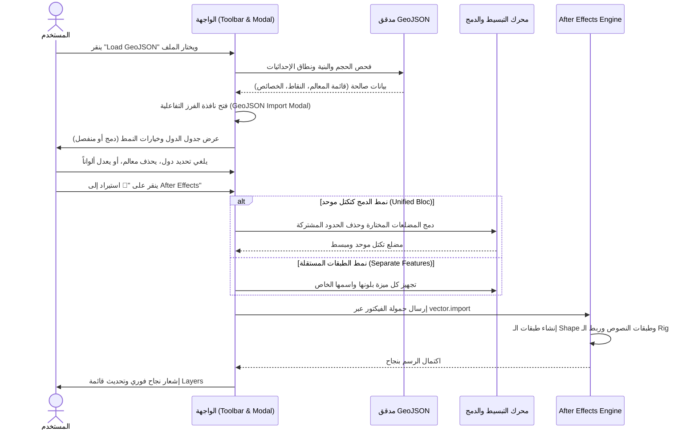

# 🗺️ خطة معمارية وتنفيذية: تطوير نظام GeoJSON وواجهة فرز وإدارة الطبقات المرفوعة

> **وثيقة التخطيط الهندسي والتصميمي الشامل** لترقية خاصية رفع ملفات الـ GeoJSON في إضافة **OpenGeo**:
> من مجرد استيراد أعمى وتلقائي إلى **منصة متكاملة لمعاينة، فحص، تصفية، وحذف المعالم، مع إمكانية الدمج كتكتل موحد أو التصدير كطبقات مستقلة** إلى Adobe After Effects.
>
> **الملف:** `docs/GEOJSON_ELEVATION_AND_LAYERS_PLAN.md`  
> **الإصدار المستهدف:** OpenGeo v1.1.0  
> **الحالة:** وثيقة معمارية جاهزة للمراجعة والتصويب قبل التنفيذ  

---

## 📑 فهرس الخطة
1. [الرؤية والأهداف الهندسية](#1-الرؤية-والأهداف-الهندسية)
2. [تصميم واجهة المستخدم الجديدة (GeoJSON Import Manager Modal)](#2-تصميم-واجهة-المستخدم-الجديدة-geojson-import-manager-modal)
3. [المحركات والقدرات الجديدة المطلوبة](#3-المحركات-والقدرات-الجديدة-المطلوبة)
   - [أ. محرك استخراج الأسماء والهوية (Feature Metadata & Identity Engine)](#أ-محرك-استخراج-الأسماء-والهوية)
   - [ب. محرك الألوان والتنسيقات (Simplestyle & Color Palette Engine)](#ب-محرك-الألوان-والتنسيقات)
   - [ج. محرك التبسيط التكيفي الذكي (Preflight Simplification Engine)](#ج-محرك-التبسيط-التكيفي-الذكي)
   - [د. محرك الدمج الموحد للتكتلات (Unified Bloc Merger Engine)](#د-محرك-الدمج-الموحد-للتكتلات)
   - [هـ. التوليد التلقائي لطبقات النصوص (Automatic Text Labels)](#هـ-التوليد-التلقائي-لطبقات-النصوص)
4. [مخطط سير العمل وسيناريو الاستخدام (Workflow Architecture)](#4-مخطط-سير-العمل-وسيناريو-الاستخدام)
5. [الملفات البرمجية المستهدفة وخريطة التعديلات](#5-الملفات-البرمجية-المستهدفة-وخريطة-التعديلات)
6. [مراحل التنفيذ خطوة بخطوة (Actionable Execution Phases)](#6-مراحل-التنفيذ-خطوة-بخطوة)
7. [مصفوفة الاختبارات وضمان الجودة الصارمة (QA & Invariants Matrix)](#7-مصفوفة-الاختبارات-وضمان-الجودة-الصارمة)

---

## 1. الرؤية والأهداف الهندسية

### أ. الوضع الحالي (The Baseline):
حالياً، عندما ينقر المستخدم على زر "Load GeoJSON" ويختار ملفاً:
1. يقوم `GeoJSONValidator` بالتحقق من سلامة البنية وحجم الملف.
2. يتم صهر **كافة مضلعات وخطوط ونقاط الملف دفعة واحدة** في مصفوفة مجهولة الهوية (`geojson-polygons`).
3. تُرسل مباشرة إلى After Effects لترسم كطبقة بلون أخضر زمردي إجباري (`#10b981`).
4. **المشاكل الناتجة:**
   * لا يستطيع المصمم اختيار دول معينة واستبعاد دول أخرى من الملف.
   * لا يمكن حذف أي معلم غير مرغوب فيه دون تعديل ملف الـ JSON يدوياً في محرر نصوص خارجي!
   * لا توجد خيارات لتلوين كل دولة بلون مختلف أو دمجها في تكتل محدد.
   * لا يتم استخراج أسماء المعالم أو عواصمها كنصوص.

### ب. الرؤية الجديدة والهدف المنشود (The Target Vision):
تحويل عملية الرفع إلى **تجربة تفاعلية سينمائية**:
* بمجرد رفع الملف، تفتح نافذة فرز أنيقة (`GeoJSON Import Manager`):
  * **عرض شجري/جدولي لكافة المعالم:** مع أسمائها المستخرجة، ونوع الهندسة، وعدد النقاط، ولونها.
  * **حرية الاختيار والحذف:** صناديق اختيار (`Checkboxes`) لتحديد ما يراد تمريره، وأزرار سلة مهملات (`Delete`) لحذف أي دولة أو معلم فوراً.
  * **خياران استراتيجيان للاستيراد:**
    1. 🔗 **دمج كتكتل موحد (Merge as One Bloc):** يدمج كل الدول المختارة في حدود خارجية واحدة مصمتة بدون فواصل داخلية (وهو ما يحل فكرة تكتل الجزائر + تونس + المغرب بضغطة زر).
    2. 🎨 **طبقات مستقلة (Separate Feature Layers):** يرسم كل دولة/معلم كعنصر مستقل داخل شجرة الطبقة مع لونه المخصص والتحكم به من `Effect Controls`.
  * **الربط مع كانفاس المعاينة (Canvas Live Highlighting):** عند الوقوف بالفأرة على أي دولة في الجدول، تضيء فوراً على الخريطة في المعاينة ليعرف المصمم بالضبط ما يقوم باختياره.
  * **حماية After Effects من التجميد:** فحص عدد النقاط تلقائياً واقتراح التبسيط الذكي إذا تجاوز الملف 4,000 نقطة.

---

## 2. تصميم واجهة المستخدم الجديدة (GeoJSON Import Manager Modal)

تصميم الواجهة يعتمد الهوية الداكنة المتميزة لإضافة OpenGeo (`Theme-Native Modern Dark Glass`):

```
┌─────────────────────────────────────────────────────────────────────────────────────────┐
│  📂 استيراد ومعالجة الخريطة: north_africa_countries.geojson                     [ ✕ ]   │
├─────────────────────────────────────────────────────────────────────────────────────────┤
│  📊 ملخص الملف: 5 معالم جغرافية │ 6,420 نقطة │ 184 KB                                  │
│  ⚠️ تنبيه الأداء: عدد النقاط مرتفع قليلاً (6.4k) ─── [ ☑ تطبيق التبسيط الذكي الآمن (LOD) ] │
├─────────────────────────────────────────────────────────────────────────────────────────┤
│  🎯 نمط الاستيراد إلى After Effects:                                                   │
│  (🔘) 🔗 دمج كتكتل موحد (Unified Bloc)          ( ) 🎨 عناصر مستقلة بألوانها (Separate)│
│       اسم التكتل: [ تكتل المغرب العربي                    ]  لون التكتل: [ 🟩 #10b981 ]│
├─────────────────────────────────────────────────────────────────────────────────────────┤
│  قائمة المعالم المكتشفة في الملف:                      [ ☑ تحديد الكل ]  [ ☐ إلغاء الكل ]│
│ ┌─────────────────────────────────────────────────────────────────────────────────────┐ │
│ │ [☑]  🇩🇿 الجزائر (Algeria)       │ مضلع (Polygon)    │ 2,410 pts │ [🟥 #e11d48] │ [🗑️] │ │
│ │ [☑]  🇹🇳 تونس (Tunisia)          │ مضلع (Polygon)    │ 1,120 pts │ [🟦 #2563eb] │ [🗑️] │ │
│ │ [☑]  🇲🇦 المغرب (Morocco)        │ مضلع (Polygon)    │ 1,980 pts │ [🟩 #059669] │ [🗑️] │ │
│ │ [☐]  🇱🇾 ليبيا (Libya)           │ مضلع (Polygon)    │ 1,850 pts │ [🟨 #d97706] │ [🗑️] │ │
│ │ [☐]  🇲🇷 موريتانيا (Mauritania)  │ مضلع (Polygon)    │ 910 pts   │ [🟪 #7c3aed] │ [🗑️] │ │
│ └─────────────────────────────────────────────────────────────────────────────────────┘ │
├─────────────────────────────────────────────────────────────────────────────────────────┤
│  خيارات متقدمة:                                                                         │
│  [☑] إنشاء طبقات نصوص ثلاثية الأبعاد للأسماء (3D Text Labels)                           │
│  [☑] ضبط موضع الكاميرا تلقائياً ليشمل نطاق الخريطة المحددة (Fit Camera to Selection)     │
├─────────────────────────────────────────────────────────────────────────────────────────┤
│  [ إلغاء الأمر ]                                [ 🚀 استيراد إلى After Effects (3 دول) ]│
└─────────────────────────────────────────────────────────────────────────────────────────┘
```

---

## 3. المحركات والقدرات الجديدة المطلوبة (Core Engines)

### أ. محرك استخراج الأسماء والهوية (Feature Metadata & Identity Engine)
* **المشكلة السابقة:** إهمال جدول البيانات `properties` بالكامل.
* **الحل:** بناء دالة ذكية تفحص الحقول الأكثر شيوعاً بالترتيب لاستخراج الاسم المعبر:
  ```javascript
  function resolveFeatureName(properties, index) {
    if (!properties || typeof properties !== 'object') return `Feature ${index + 1}`;
    return properties.name_ar || properties['name:ar'] ||
           properties.name || properties.NAME ||
           properties.title || properties.admin ||
           properties.SOVEREIGNT || properties.NAME_EN ||
           properties.id || `Feature ${index + 1}`;
  }
  ```

---

### ب. محرك الألوان والتنسيقات (Simplestyle & Color Palette Engine)
* **المشكلة السابقة:** لون أخضر إجباري ثابت لجميع الملفات.
* **الحل:**
  1. فحص معايير الـ Simplestyle:
     * `fill` أو `fillColor` أو `color` للتعبئة.
     * `stroke` أو `strokeColor` للحدود.
     * `stroke-width` لسماكة الخط.
  2. إذا لم تكن الألوان محددة في الملف:
     * توليد لوحة ألوان متناسقة تلقائياً (Harmonious Curated Palette) عبر عجلة HSL المتباعدة لتمييز كل دولة بلون أنيق، مع إتاحة منتقي ألوان (`Color Picker`) في الجدول لتعديل لون أي دولة قبل الاستيراد.

---

### ج. محرك التبسيط التكيفي الذكي (Preflight Simplification Engine)
* **المشكلة السابقة:** دخول ملفات ذات 30 ألف نقطة إلى AE وتجميد البرنامج.
* **الحل:**
  * إذا كان إجمالي نقاط المعالم المختارة $> 4,000$ نقطة:
  * يظهر تنبيه أداء في الواجهة، ويتم تفعيل التبسيط التلقائي (بمعامل تسامح $\epsilon$ ديناميكي باستخدام خوارزمية Douglas-Peucker).
  * خفض النقاط بنسبة 40-70% مع الحفاظ التام على الملامح الجغرافية المرئية، مما يضمن رندرة فائقة السرعة (60 FPS) في After Effects.

---

### د. محرك الدمج الموحد للتكتلات (Unified Bloc Merger Engine)
* **المشكلة السابقة:** عدم وجود خيار لإذابة الحدود الداخلية بين عدة دول لتشكيل تكتل موحد.
* **الحل:**
  * إذا اختار المستخدم **وضع الدمج (Unified Bloc)**:
  * يتم أخذ مضلعات الدول المحددة فقط وتمريرها عبر `@turf/union` محلياً في الـ Client.
  * تطبيق إغلاق الفجوات المجهرية (Micro-Gaps Snapping) لمنع أي فواصل شقية داخلية.
  * النتيجة: مضلع خارجي موحد بدون أي خطوط تقسيم داخلية، يرسم في AE ككتلة واحدة باسم التكتل المحدد (مثل "المغرب العربي").

---

### هـ. التوليد التلقائي لطبقات النصوص (Automatic Text Labels)
* **المشكلة السابقة:** مصفوفة المسميات `labels: []` كانت فارغة دائماً.
* **الحل:**
  * لكل دولة أو معلم مختار:
    * إذا كان معلماً نقطياً (عاصمة/مدينة): استخدام إحداثيات النقطة مباشرة.
    * إذا كان مضلعاً (دولة/إقليم): حساب مركز الكتلة الجغرافية (`Center of Mass`).
  * تمرير هذه المراكز إلى `vectorHost.jsx` لإنشاء طبقات نصوص ثلاثية الأبعاد تحمل اسم الدولة، وتتبع حركة الكاميرا والزووم تلقائياً.

---

## 4. مخطط سير العمل وسيناريو الاستخدام (Workflow Architecture)



---

## 5. الملفات البرمجية المستهدفة وخريطة التعديلات

| الملف المستهدف | نوع التعديل | الدور والمسؤولية الجديدة |
|---|---|---|
| **[client/index.html](file:///c:/Program%20Files%20%28x86%29/Common%20Files/Adobe/CEP/extensions/OpenGeo/client/index.html)** | تعديل DOM | إضافة هيكل نافذة الـ Modal (`#geojson-import-modal`) وجدول المعالم وأزرار التحكم |
| **`client/js/ui/GeoJSONImportModal.js`** | **ملف جديد** | إدارة منطق النافذة المنبثقة: العرض، التفاعل، الحذف، التحديد، وتغيير الألوان |
| **[client/js/ui/ToolbarController.js](file:///c:/Program%20Files%20%28x86%29/Common%20Files/Adobe/CEP/extensions/OpenGeo/client/js/ui/ToolbarController.js)** | تعديل وربط | تعديل `_finishGeoJSONLoad` لتمرير البيانات إلى النافذة بدلاً من الاستيراد المباشر |
| **[client/js/core/VectorMapManager.js](file:///c:/Program%20Files%20%28x86%29/Common%20Files/Adobe/CEP/extensions/OpenGeo/client/js/core/VectorMapManager.js)** | تطوير محوري | بناء دوال استخراج الألوان والأسماء، ودعم وضع الدمج (`Merge Mode`) والمسميات |
| **[client/js/overlays/GeoJSONLayer.js](file:///c:/Program%20Files%20%28x86%29/Common%20Files/Adobe/CEP/extensions/OpenGeo/client/js/overlays/GeoJSONLayer.js)** | تحسين تفاعلي | دعم إبراز الميزة النشطة على الكانفاس (`highlightFeature`) وتحديث العرض عند الحذف |
| **[client/js/app.js](file:///c:/Program%20Files%20%28x86%29/Common%20Files/Adobe/CEP/extensions/OpenGeo/client/js/app.js)** | تسجيل | تهيئة وتسجيل `GeoJSONImportModal` ضمن دورة حياة التطبيق |
| **[host/modules/vectorHost.jsx](file:///c:/Program%20Files%20%28x86%29/Common%20Files/Adobe/CEP/extensions/OpenGeo/host/modules/vectorHost.jsx)** | ترقية الأنماط | دعم استيراد طبقات بشكل مجموعات متعددة الألوان وإنشاء طبقات النصوص التلقائية |

---

## 6. مراحل التنفيذ خطوة بخطوة (Actionable Execution Phases)

### 🔹 المرحلة 1: بناء وتصميم نافذة الفرز المنبثقة (Modal UI & DOM Component)
1. إنشاء قالب الـ HTML في `client/index.html` بتنسيق داكن مدمج مع نظام الأيقونات `Lucide`.
2. إنشاء كائن `GeoJSONImportModal.js`:
   * ربط أزرار التحديد والفرز والإلغاء.
   * توليد صفوف المعالم ديناميكياً مع أسماء الدول المستخرجة، وأزرار الحذف والتلوين.
   * إشعار الكانفاس لتلوين/إبراز الدولة عند التمرير بالفأرة (`Hover`).

### 🔹 المرحلة 2: محرك البيانات والألوان والدمج (Client Processing Engine)
1. كتابة دوال استخراج الأسماء من `properties` في `VectorMapManager.js`.
2. دعم قراءة الـ Simplestyle أو توليد لوحة ألوان تلقائية.
3. دمج دالة التبسيط التلقائي (Douglas-Peucker) إذا تجاوز عدد النقاط ميزانية الأمان.
4. دمج خيار الدمج المكاني (`@turf/union`) عند اختيار المستخدم وضع "الدمج كتكتل موحد".

### 🔹 المرحلة 3: ربط الدورة البرمجية والاستيراد لـ After Effects
1. تعديل `ToolbarController.js`: عند انتهاء قراءة الملف، يتم فتح الـ Modal وإيقاف الاستيراد التلقائي.
2. عند نقر المستخدم "استيراد إلى AE"، يتم تجميع المعالم النشطة والمختارة فقط وتمريرها إلى `VectorMapManager.drawGeoJSONInAE`.
3. توليد حمولة المتجه مع مصفوفة الـ `labels` لإنشاء النصوص في التايملاين.

### 🔹 المرحلة 4: التحقق والاختبار وضمان الجودة (QA Verification)
1. كتابة جناح اختبار مخصص: `scripts/tests/vector/geojson-import-manager.test.js`.
2. التحقق من:
   * تصفية المعالم: التأكد من أن المعالم الملغاة أو المحذوفة لا تظهر في الحمولة ولا تُرسل لـ AE.
   * نمط الدمج: التأكد من إزالة الحدود المشتركة وإنتاج مضلع موحد.
   * أمان النقاط: التأكد من أن التبسيط يمنع تجاوز السقف الآمن في AE.
   * استقرار كافة اختبارات الـ 162 وحدة واختبارات الـ 19 Master QA بنسبة 100%.

---

## 7. مصفوفة الاختبارات وضمان الجودة الصارمة (QA & Invariants Matrix)

| الاختبار | الشرط الحرج للنجاح | التأثير الممنوع |
|---|---|---|
| **انتقاء معالم محددة** | استيراد 3 دول فقط من أصل 5 في الملف | منع تسرب أي دولة غير محددة إلى After Effects |
| **نمط الدمج الموحد** | إنتاج طبقة Shape واحدة بحدود خارجية مصمتة | منع وجود فواصل شقية مجهرية داخلية |
| **استخراج النصوص** | إنشاء طبقة Text ثلاثية الأبعاد لكل معلم له اسم | منع تعليق البرنامج إذا كان حقل الاسم فارغاً |
| **سقف أمان النقاط** | خفض نقاط الملفات الكبيرة لما دون 5,000 نقطة | منع تجميد After Effects بنسبة 100% |
| **المعاملات الذرية** | دعم التراجع التام بـ Ctrl+Z وإلغاء الاستيراد بأمان | منع ترك طبقات مؤقتة ميتة في المشروع |

---

## 8. الخاتمة

هذه الخطة تحقق المعادلة الذهبية التي طلبتها:
1. **الابتعاد عن المخاطرة والتعقيدات غير المحسوبة.**
2. **استغلال قوة ومرونة صيغة الـ GeoJSON العالمية.**
3. **منح المصمم تحكماً بصرياً كاملاً في اختيار ما يريد حذفه وما يريد تمريره، مع حرية الاختيار بين دمج الدول كتكتل موحد أو كدول مستقلة ملونة.**
