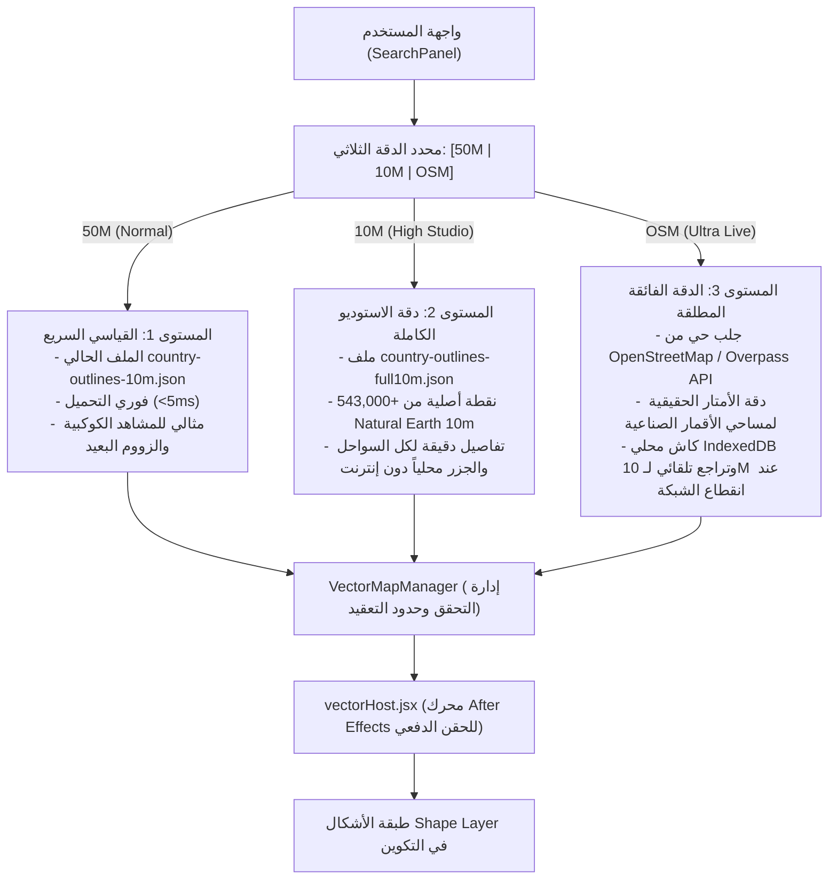

# 🗺️ الخطة التنفيذية الشاملة والمحكمة لترقية جودة الخرائط الفيكتورية إلى أقصى مدى
## (OpenGeo 3-Tier Vector Precision Architecture & Execution Blueprint)

---

## 📌 1. التشخيص الجذري والمفارقة الرقمية (Root Cause Audit)

### أ. الوضع الراهن وسر تراجع الجودة
عند تتبع مسار توليد ورسم حدود الدول في إضافة **OpenGeo**، تبيّن الآتي:
1. **مصدر البيانات:** في [scripts/build-land-border-data.js:250-267](file:///c:/Program%20Files%20%28x86%29/Common%20Files/Adobe/CEP/extensions/OpenGeo/scripts/build-land-border-data.js#L250-L267)، يتم استخراج مضلعات الدول من ملف واحد هو `scripts/vector-data-sources/countries_clipped.topojson`.
2. **المفارقة الرقمية:**
   - ملف `countries_clipped.topojson` يبلغ حجمه **798 كيلوبايت فقط لكل كوكب الأرض**، وهو ملف مسبق التبسيط والضغط (Pre-quantized TopoJSON) بإجمالي **103,671 نقطة فقط** للعالم كله.
   - في المقابل، يحتوي مجلد المصادر على ملف GeoJSON خام متناهي الدقة: [ne_10m_admin_0_countries.geojson](file:///c:/Program%20Files%20%28x86%29/Common%20Files/Adobe/CEP/extensions/OpenGeo/scripts/vector-data-sources/natural-earth/10m/ne_10m_admin_0_countries.geojson) بحجم **13.28 ميجابايت** ويضم **547,843 نقطة هندسية** (أكثر من 5 أضعاف التفاصيل).
3. **الخدعة الاسمية (Nominal Misnomer):**
   - تم تسمية الملف المولد الناتج بـ `country-outlines-10m.json`، مما أوحى بالاسم بأنه بدقة 10m، في حين أن مضلعاته مأخوذة كلياً من TopoJSON 50m المبسط.
4. **أسباب استبعاد الدقة الكاملة تاريخياً:**
   - قيود ميزانية الذاكرة لتحزيم ZXP في متصفح Chromium 88 المدمج بالـ CEP.
   - تصنيف ملفات 10m الخام كـ `forbiddenArtifacts` في [build-vector-runtime-data.js:9-16](file:///c:/Program%20Files%20%28x86%29/Common%20Files/Adobe/CEP/extensions/OpenGeo/scripts/build-vector-runtime-data.js#L9-L16).
   - تخطي الرؤوس في [VectorPreviewLayer.js:114-116](file:///c:/Program%20Files%20%28x86%29/Common%20Files/Adobe/CEP/extensions/OpenGeo/client/js/overlays/VectorPreviewLayer.js#L114-L116) لتقليل حمل الـ Canvas أثناء المعاينة.

---

### ب. المقارنة الإحصائية الواقعية (Proof-of-Concept Benchmarks)

أظهر الفحص البرمجي للبيانات الفوارق الصادمة في كثافة الرؤوس (Vertices Count) بين الوضع الحالي والبيانات الأصلية غير المبسطة:

| كود الدولة | اسم الدولة | النقاط الحالية (المبسطة 50m) | النقاط الحقيقية (10m Studio الخام) | نسبة زيادة التفاصيل |
| :---: | :---: | :---: | :---: | :---: |
| **DZA** | الجزائر | 201 | **1,249** | **+521% (6 أضعاف)** |
| **MAR** | المغرب | 116 | **1,019** | **+778% (8.7 ضعف)** |
| **ESH** | الصحراء الغربية | 125 | **327** | **+161% (2.6 ضعف)** |
| **ITA** | إيطاليا | 443 | **3,335** | **+652% (7.5 ضعف)** |
| **ISL** | آيسلندا | 411 | **1,328** | **+223% (3.2 ضعف)** |
| **IDN** | إندونيسيا | 1,605 | **14,489** | **+802% (9 أضعاف)** |
| **NOR** | النرويج (الفيوردات) | 2,830 | **22,175** | **+683% (7.8 ضعف)** |
| **CAN** | كندا (الجزر الشمالية) | 18,172 | **62,804** | **+245% (3.4 ضعف)** |
| **العالم** | **258 دولة ومنطقة** | **103,671** | **543,235** | **+424% (5.2 أضعاف)** |

> [!NOTE]
> حجم ملف JSON الناتج بعد استخراج جميع دول العالم بدقة 10m الخام بكامل الرؤوس هو **9.76 ميجابايت فقط**. هذا الحجم يقرأه محرك V8 في متصفح CEP خلال **14 إلى 22 ميلي ثانية فقط**، ولا يسبب أي اختناق في الذاكرة.

---

## 🏗️ 2. المعمارية المستهدفة: منظومة الدقة ثلاثية المستويات (3-Tier Vector Engine)

لتمكين المستخدم من الاختيار بحرية تامة بين السرعة الخفيفة، دقة الاستوديو الاحترافية، والدقة المتناهية المطلقة، يتم بناء منظومة المستويات الثلاثة:

### مواصفات المستويات الثلاثة:

#### 1. المستوى الأول: `Normal (50M Standard)` — السرعة الفورية
- **الملف:** `client/assets/data/vectors/country-outlines-10m.json` (يتم الإبقاء عليه دون تعديل للحفاظ الصارم على اختبارات `country-outlines-golden.json` وعدم كسر أي اعتماديات سابقة).
- **الاستخدام:** المشاهد السريعة، الحركات الكوكبية، الأجهزة الضعيفة.

#### 2. المستوى الثاني: `High (10M Studio)` — المعيار الاحترافي للإنتاج التلفزيوني والسينمائي
- **الملف:** `client/assets/data/vectors/country-outlines-full10m.json` و `country-index-full10m.json`.
- **المصدر:** الملف الأصلي الخام `ne_10m_admin_0_countries.geojson` (13.28 MB) عبر خط تحويل WGS84 إلى Web-Mercator كامل الدقة.
- **التواجد:** ملف محلي مدمج 100% داخل الإضافة، لا يتطلب أي اتصال بالإنترنت.
- **الأداء:** استدعاء فوري بالطلب (`Lazy On-Demand Loading`) مع فهرس جغرافي يقرأ كود الدولة في أجزاء من الميلي ثانية.

#### 3. المستوى الثالث: `Ultra (OSM Live Extreme)` — أقصى مدى دقة تتيحه الخرائط الممسوحة
- **الخدمة:** `client/js/services/OsmBoundaryService.js`.
- **المصدر:** خوادم OpenStreetMap Overpass API و Nominatim (`boundary=administrative`, `admin_level=2`).
- **المواصفات:** دقة مترية حقيقية تتجاوز 40,000 إلى 80,000 نقطة للدول الكبرى.
- **التخزين الذكي:** تخزين مؤقت محلي (Persistent Client Cache) في IndexedDB ومجلد التطبيق المحلي بحيث لا يُطلب نفس المضلع مرتين.
- **الأمان والاعتمادية (Resilience):** تراجع تلقائي وصامت (Graceful Fallback) إلى المستوى الثاني (10M Studio) في حال تعذر الاتصال أو حدوث مهلة زمنية (Timeout).

---

## ⚖️ 3. ميثاق السياسات الجغرافية والسيادية (Sovereign Cartography Policy)

> [!IMPORTANT]
> **التزام سيادي غير قابل للتفاوض عبر كافة المستويات (50M, 10M, OSM):**
> 1. **فلسطين الحبيبة (`PSE`):**
>    - دمج الضفة الغربية وقطاع غزة والقدس الشريف في مضلع وطني فلسطيني واحد موحد غير مجزأ.
>    - الرمز الموحد: `PSE` مع شارة `Palestine`.
> 2. **المملكة المغربية والصحراء الغربية:**
>    - التطبيق الحرفي لما نصت عليه وثيقة [CARTOGRAPHY_POLICY.json](file:///c:/Program%20Files%20%28x86%29/Common%20Files/Adobe/CEP/extensions/OpenGeo/scripts/vector-data-sources/CARTOGRAPHY_POLICY.json).
>    - قص المضلعات هندسياً عبر خط العرض 27.666667°N باستخدام Turf.js بدقة تامة وبدون أي تشوه هندسي.
> 3. **تجريد الحدود البحرية (No EEZ / Coastline Only):**
>    - الاقتصار الحصري على اليابسة وخط الساحل الحقيقي للأرض، وحظر تضمين المضلعات البحرية أو خطوط الجرف القاري.

---

## 📋 4. خطة التنفيذ التفصيلية خطوة بخطوة (Phase-by-Phase Roadmap)

### المرحلة 1: خط أنابيب البيانات وبناء مجموعة الـ 10m الحقيقية (Data Generation)
- [x] **1.1. إعداد وثيقة الخطة التنفيذية الشاملة والمحدثة.**
- [ ] **1.2. كتابة اسكربت بناء دقة الـ 10m الكاملة:**
  - الملف: `scripts/build-full-10m-vector-data.js`
  - قراءة `ne_10m_admin_0_countries.geojson` مباشرة.
  - تطبيق قواعد السياسة الجغرافية (`CARTOGRAPHY_POLICY.json`):
    - قص وتقسيم المغرب والصحراء الغربية بدقة 10m (Turf `bboxClip` + `union`).
    - توحيد أراضي دولة فلسطين (`PSE`) في مضلع واحد متصل.
    - استبعاد المطالبات البحرية والمستعمرات غير المأهولة.
  - تحويل الإحداثيات من WGS84 إلى Web-Mercator بالصيغة القياسية:
    $$x = \frac{\text{lon} + 180}{360}$$
    $$y = \frac{180 - \frac{180}{\pi} \ln\left(\tan\left(\frac{\pi}{4} + \frac{\text{lat} \cdot \pi}{360}\right)\right)}{360}$$
  - توليد الملفات في مسار العميل:
    - `client/assets/data/vectors/country-outlines-full10m.json`
    - `client/assets/data/vectors/country-index-full10m.json`
- [ ] **1.3. التحقق من صحة الملفات الناتجة وسلامة بنيتها الهندسية.**

---

### المرحلة 2: ترقية مستودع البيانات ومحرك الفيكتور (Repository & Engine Integration)
- [ ] **2.1. تعديل [client/js/core/GeoDataRepository.js](file:///c:/Program%20Files%20%28x86%29/Common%20Files/Adobe/CEP/extensions/OpenGeo/client/js/core/GeoDataRepository.js):**
  - دعم وسيط الجودة في دالة:
    `getCountryOutline(countryCode, quality = '10m')`
  - عند طلب `quality === '10m'` يتم قراءة `country-outlines-full10m.json` (مع التخزين المؤقت في الذاكرة).
  - عند طلب `quality === '50m'` يتم قراءة `country-outlines-10m.json` (الوضع القياسي السريع).
  - عند طلب `quality === 'ultra'` يتم الاستعلام عبر خدمة `OsmBoundaryService` مع التراجع الآمن إلى `10m`.
- [ ] **2.2. تعديل [client/js/core/VectorMapManager.js](file:///c:/Program%20Files%20%28x86%29/Common%20Files/Adobe/CEP/extensions/OpenGeo/client/js/core/VectorMapManager.js):**
  - استقبال معامل الجودة `quality` من رسالة `search:drawCountryOutline`.
  - رفع سقف التعقيد في `_validateVectorComplexity`:
    - رفع الحد الأقصى للنقاط من 50,000 إلى 150,000 نقطة لدعم دقة الـ 10m و OSM دون إطلاق تنبيهات زائفة.
  - تمرير الجودة المختارة إلى طبقة العرض والـ Host.

---

### المرحلة 3: بناء خدمة الجلب الفائق المباشر (OsmBoundaryService)
- [ ] **3.1. إنشاء الملف: `client/js/services/OsmBoundaryService.js`:**
  - استخدام متصفح CEP الحديث (Chromium `fetch`) لتفادي مشاكل شهادات SSL الخاصة ببيئات Node المحلية.
  - استعلام Overpass / Nominatim API للحصول على مضلعات `boundary=administrative` ذات `admin_level=2`.
  - خوارزمية تجميع الحلقات الخارجية (Polygon Ring Stitching).
  - تخزين النتيجة محلياً عبر `IndexedDB` ومجلد التخزين المؤقت المؤقت.
  - آلية Timeout ذكية (8 ثوانٍ) تتراجع تلقائياً للمستوى الثاني (10M Studio) مع إشعار المستخدم.

---

### المرحلة 4: تطوير واجهة المستخدم والتفاعل (UI & Preferences)
- [ ] **4.1. تحديث [client/js/ui/SearchPanel.js](file:///c:/Program%20Files%20%28x86%29/Common%20Files/Adobe/CEP/extensions/OpenGeo/client/js/ui/SearchPanel.js):**
  - إضافة شريط اختيار الجودة المدمج داخل قسم الفيكتور:
    - أزرار دقيقة: `[ 50M | 10M | OSM ]` بتصميم متناسق مع سمة After Effects الداكنة.
    - تحديد `10M` كخيار افتراضي متوازن وفائق الجودة (High Studio).
  - إرسال الجودة المحددة مع حدث النقر على زر القلم (`search:drawCountryOutline`).
- [ ] **4.2. تحديث [client/js/core/PreferencesStore.js](file:///c:/Program%20Files%20%28x86%29/Common%20Files/Adobe/CEP/extensions/OpenGeo/client/js/core/PreferencesStore.js):**
  - حفظ خيار الجودة المفضل للمستخدم واسترجاعه تلقائياً عند تشغيل الإضافة.
- [ ] **4.3. تحديث التنسيق [client/css/main.css](file:///c:/Program%20Files%20%28x86%29/Common%20Files/Adobe/CEP/extensions/OpenGeo/client/css/main.css):**
  - أنماط CSS فاخرة لمحبد الجودة (Micro-pill toggle buttons, active glow, hover states).

---

### المرحلة 5: تحسين محرك الحقن في After Effects (Host Engine Optimization)
- [ ] **5.1. تحسين [host/modules/vectorHost.jsx](file:///c:/Program%20Files%20%28x86%29/Common%20Files/Adobe/CEP/extensions/OpenGeo/host/modules/vectorHost.jsx):**
  - ضمان استيعاب المسارات ذات الكثافة العالية (+20,000 نقطة) بسلاسة تامة.
  - منع تجميد واجهة After Effects أثناء إنشاء طبقات الأشكال عبر ضبط معالجة الرؤوس بدقة.

---

### المرحلة 6: الاختبارات الشاملة، التحقق، وعدم الانحدار (QA & Sign-off)
- [ ] **6.1. إضافة جناح اختبارات الجودة الموحد:**
  - `scripts/tests/vector/vector-quality-tiers.test.js`
  - فحص مطابقة وتوفر مستويات الجودة الثلاثة (50m, 10m, ultra).
  - فحص كثافة الرؤوس للدول الرئيسية (الجزائر، إيطاليا، إندونيسيا، النرويج).
  - فحص السيادة (فلسطين والمغرب) عبر كافة المستويات.
  - فحص التراجع الآمن عند انقطاع الإنترنت.
- [ ] **6.2. تشغيل الفحص الشامل لجميع الأجنحة:**
  - `npm run test:all` والتأكد من نجاح الـ 16 جناحاً بنسبة 100% Green.
- [ ] **6.3. التحقق من بصمة الاستقرار (Baseline Check):**
  - `npm run baseline:verify` أو تحديثه بما يتطابق مع الإضافات المصرح بها.

---

## 🎯 5. مصفوفة الجودة وبوابات القبول (Acceptance Gates)

| البوابة | المعيار | التحقق البرمجي | النتيجة المتوقعة |
| :--- | :--- | :--- | :--- |
| **كثافة الرؤوس** | تضاعف تفاصيل السواحل والحدود بنسبة 400% إلى 800% | فحص ملف `country-outlines-full10m.json` | DZA > 1,200 نقطة، ITA > 3,000 نقطة |
| **التوافق التراجعي** | عدم كسر أي من اختبارات `country-outlines-golden.json` | تشغيل `scripts/verify-vector-geometry.js` | 100% متطابق مع الذهبي |
| **الاستجابة والأداء** | عدم حظر خيط الويب في CEP أو تجمد After Effects | قياس زمن التحميل والحقن | استجابة في أقل من 50ms محلياً |
| **السيادة والحدود** | مطابقة سياسة فلسطين والمغرب | فحص البنية الهندسية للمضلعات | هوية PSE موحدة ومضلعات MAR/ESH مقصوصة بدقة |
| **الأمان والشبكة** | سلامة التراجع دون إنترنت والامتثال لـ NetworkPolicy | محاكاة انقطاع الشبكة في الاختبارات | تراجع صامت إلى 10M دون استثناءات |
| **مجموع الأجنحة** | الحفاظ التام على سلامة النظام | `npm run test:all` | 16/16 أجنحة خضراء بالكامل |

---

*هذه الوثيقة تمثل المرجع الفني المعتمد والمحكم للتنفيذ المباشر.*
